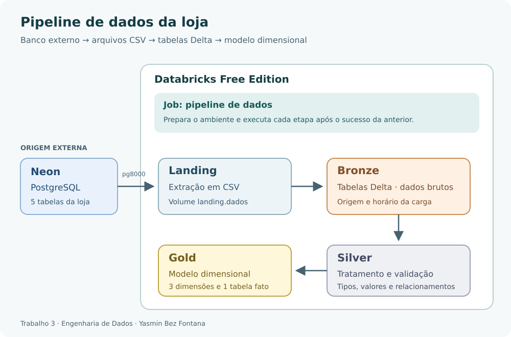
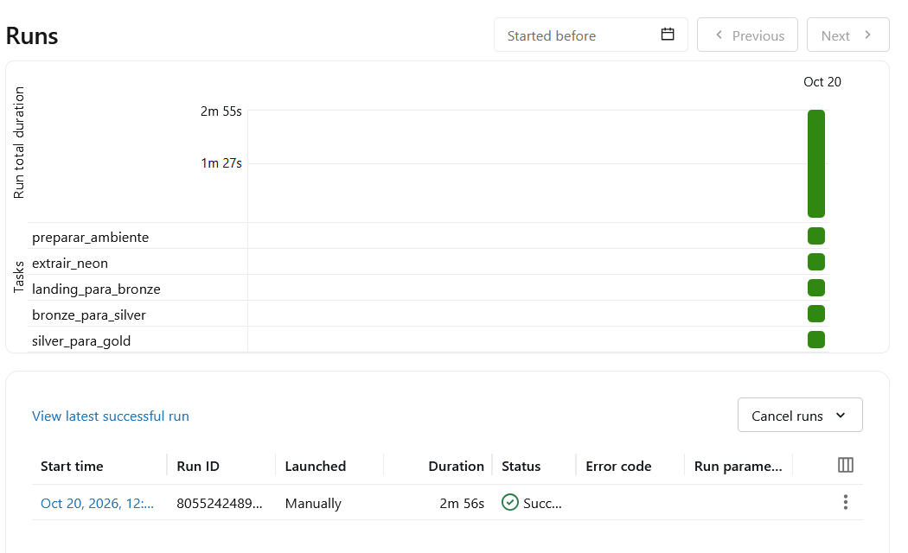

# Trabalho 3 — Lakehouse com Databricks

**Participante:** Yasmin Bez Fontana  
**Disciplina:** Engenharia de Dados

Este trabalho implementa um pipeline de dados de uma loja, utilizando PostgreSQL no Neon como origem e Databricks Free Edition para processamento.

O pipeline segue a arquitetura Medalhão, com as camadas Landing, Bronze, Silver e Gold. A execução dos notebooks é encadeada por um Job.

O cenário reaproveita a loja dos trabalhos anteriores, com cinco tabelas e 32 registros fictícios criados para a atividade. Não foi utilizado dataset externo.

## Etapas do pipeline

1. **Preparação:** criação dos schemas `landing`, `bronze`, `silver` e `gold`, além do volume para armazenar os CSVs.
2. **Extração:** leitura das cinco tabelas do PostgreSQL no Neon e gravação de um CSV por tabela na Landing.
3. **Bronze:** conversão dos CSVs em tabelas Delta, preservando os dados brutos e acrescentando informações de origem e processamento.
4. **Silver:** tratamento dos textos, conversão dos tipos e validação de campos obrigatórios, identificadores, valores e relacionamentos.
5. **Gold:** criação e alimentação das dimensões produto, cliente e tempo e da tabela fato de itens de pedido.

O Job **pipeline de dados** executa essas etapas sequencialmente. Cada tarefa começa somente após o sucesso da anterior.

## Conjunto de dados

Os dados representam uma loja com duas categorias de produtos, clientes e seus pedidos.

| Tabela | Quantidade inicial |
|---|---:|
| categorias | 2 |
| clientes | 5 |
| produtos | 10 |
| pedidos | 5 |
| itens_pedido | 10 |
| **Total** | **32** |

Uma categoria pode ter vários produtos. Um cliente pode fazer vários pedidos, e cada pedido possui itens que referenciam os produtos.

## Resultados e validações

A Landing recebeu cinco arquivos CSV, totalizando 32 registros. Os cabeçalhos e as quantidades foram conferidos após a extração.

A Bronze armazenou os dados em cinco tabelas Delta. Na Silver, foram tratados os textos, convertidos os tipos e validados os campos obrigatórios, a unicidade dos identificadores, os valores numéricos e os relacionamentos.

Na Gold, foram obtidos:

| Tabela | Registros |
|---|---:|
| dim_produto | 10 |
| dim_cliente | 5 |
| dim_tempo | 365 |
| fato_itens_pedido | 10 |

Cada linha da tabela fato representa um item de pedido. O valor total dos itens foi de **R$ 690,40**, incluindo pedidos concluídos e em preparação. Esse valor foi conferido com o cálculo realizado na Silver.

A execução completa do Job terminou com sucesso em **2 minutos e 56 segundos**, em 20/10/2026.

## Organização do repositório

| Pasta ou arquivo | Conteúdo |
|---|---|
| `notebooks/` | Notebooks no formato Source do Databricks (`.py`), com explicações em Markdown |
| `notebooks_ipynb/` | Os mesmos notebooks em formato Jupyter, para facilitar a leitura no GitHub |
| `sql/` | Código de criação e preenchimento das tabelas no Neon |
| `jobs/` | Configuração do Job e das dependências entre as tarefas |
| `docs/` | Páginas da documentação |
| `mkdocs.yml` | Configuração do MkDocs |
| `pyproject.toml` | Dependência para construir a documentação localmente |
| `execucao_job.png` | Evidência da execução completa com sucesso |

As duas pastas de notebooks contêm o mesmo código. Para executar no Databricks, basta importar uma das versões. Os arquivos `.ipynb` não incluem as saídas de execução.

## Como executar

1. Crie um banco PostgreSQL no Neon e execute o arquivo `sql/01_criar_e_popular_neon.sql`.
2. No Databricks, crie o secret scope `loja_neon` e armazene a URL de conexão na chave `connection_url`.
3. Importe os notebooks para uma pasta no Workspace.
4. Utilize o ambiente Serverless e execute os notebooks nesta ordem:

| Ordem | Notebook |
|---|---|
| 00 | `00_preparar_ambiente` |
| 01 | `01_extrair_neon` |
| 02 | `02_landing_para_bronze` |
| 03 | `03_bronze_para_silver` |
| 04 | `04_silver_para_gold` |

Para automatizar, configure um Job com uma tarefa por notebook, seguindo essa mesma ordem. Cada tarefa deve depender do sucesso da anterior. Os arquivos da pasta `jobs/` registram a configuração utilizada.

A credencial do Neon é recuperada pelos Secrets, sem ficar escrita no código. O notebook de extração utiliza o driver `pg8000`.

O pipeline é executado na nuvem e não depende do Docker ou do MinIO utilizados no trabalho anterior.

## Documentação

A documentação utiliza **MkDocs Material** e será publicada no GitHub Pages:

https://bfontanayasmin.github.io/trabalhoEngdeDados3/

## Referências

- Slides e notebooks disponibilizados pelo professor para o Trabalho 3.
- [Databricks](https://docs.databricks.com/aws/en/).
- [Neon](https://neon.com/docs).
- [pg8000](https://pypi.org/project/pg8000/).
- [MkDocs Material](https://squidfunk.github.io/mkdocs-material/).
